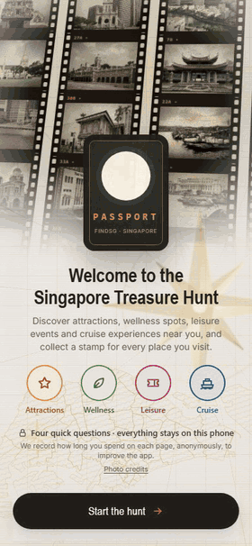
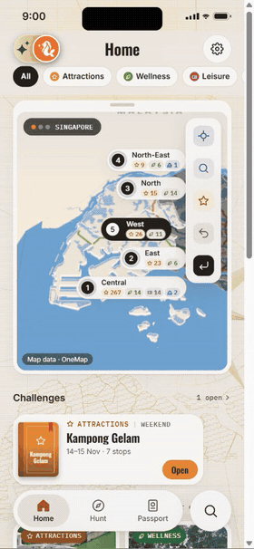
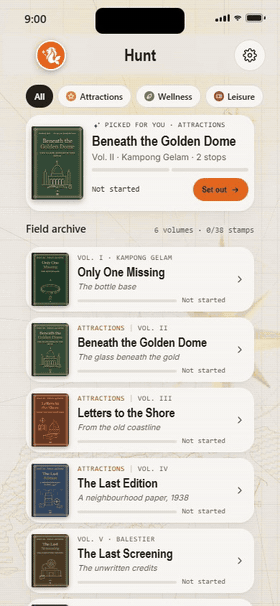

# FindSG

**Discover Singapore through its stories: a map, a treasure hunt and a passport.**

### [Open FindSG →](https://cde-5311.vercel.app)

<table>
  <tr>
    <td align="center"></td>
    <td align="center"></td>
    <td align="center"></td>
  </tr>
  <tr>
    <td align="center"><b>Get started</b>: pick what you want to explore</td>
    <td align="center"><b>Explore</b>: region → area → 3D place</td>
    <td align="center"><b>Hunt</b>: play a story through the city</td>
  </tr>
</table>

---

FindSG helps you find Singapore's lesser-known places and the stories behind them. Every place belongs to one of
four categories from the Singapore Tourism Board's **Tourism 2040** plan:

| | Category | What you'll find |
|---|---|---|
| 🟠 | **Attractions** | Landmarks, heritage streets, museums and precincts |
| 🟢 | **Wellness** | Parks, gardens, nature trails and quiet spots |
| 🟣 | **Leisure** | Events, festivals and places to unwind |
| 🔵 | **Cruise** | The waterfront, the harbour and the islands |

No account, no download. FindSG runs in your phone's browser.

---

## Getting started

1. **Open** [cde-5311.vercel.app](https://cde-5311.vercel.app) on your phone.
2. **Tap _Start the hunt_** and answer three quick questions:
   - **What would you like to explore?** Tap the categories in the order you like them. Home shows your first
     pick first.
   - **Hunt with others nearby?** Choose *Yes, hunt together* for weekend challenges and leaderboards, or *Not now*
     to explore on your own. Then pick your home region.
   - **Review.** Check your answers, then tap **Stamp my passport**.
3. **You're in.** You land on Home.

> **Tip:** add FindSG to your home screen (in Safari, tap **Share → Add to Home Screen**; in Chrome, tap
> **⋮ → Add to Home screen**) and it opens like an app.

---

## Using FindSG

The tab bar at the bottom takes you to **Home**, **Hunt** and **Passport**. The round button beside it is **Search**.

### Home: explore the map

- **Tap a region** on the map to see its areas, then **tap an area** to see its places. Tap a place to open its card.
- **Filter by category** with the chips at the top (*All*, *Attractions*, *Wellness*, *Leisure*, *Cruise*). The
  numbers on the map show how many places of each kind there are.
- **Use the map buttons** on the right to find your location, search the map, see the editor's picks, step back a
  level or open the place you've selected.
- **Scroll down** for this weekend's **challenges** and places **picked for you** from your favourite categories.

### Place pages

Each place has photos, what's worth knowing before you go, and its story. From a place you can:

- **Save** it (☆) to come back to later.
- **Check in** when you're there. Check-ins are on trust: FindSG shows how far away you are, but never checks for you.

### Hunt: play a story

- The **field archive** lists the story **volumes**. Each one is a route through real places in one neighbourhood.
- Tap **Set out** to start a volume, or **Continue** to pick up where you left off.
- **Every stop has three moves:** go to the place, spot the detail on the building, then keep the clue. The clue
  moves the story on. You can play on site or from anywhere.

### Passport

Your stamps, the places you've visited and your progress in each category, all in one place.

### Search

Look up places, challenges and volumes by name. Results are grouped by category, and your recent searches are kept
for next time.

### Moments

Keep a travel journal of your visits and turn it into a **travelogue** to share.

### Settings

Open Settings with the ⚙ button at the top of Home or Hunt. You can:

- Re-rank your **categories**, or switch between hunting **together** and **on your own**.
- Change your **language** and **home base**.
- Turn on **Reduce motion** or make the **text bigger**.
- **Redo onboarding**, see **Privacy & data**, or **send feedback**.

### Need help?

Tap the **lion** in the top-left corner of Home or Hunt. It answers common questions and has a form for feedback.

---

## Your privacy

- **Your data stays on your phone.** Your choices, visits, stamps and journal photos are saved in your browser, not
  on a server.
- **Your location is never saved.** FindSG uses it only while the app is open, to show what's near you and how far
  away a place is.
- **You're in control.** Delete everything at any time in **Settings → Privacy & data** (press and hold the delete
  button).
- FindSG records how long screens stay open and which buttons are pressed, anonymously, to improve the app. It never
  records what you type.

---

## Good to know

- FindSG is a **student prototype**. It isn't affiliated with or endorsed by the Singapore Tourism Board.
- Hunt stories are set in real places and draw on real history, but the stories and their characters are fiction.
- On leaderboards, every player except you is sample data. The app says so.
- Opening hours and event dates can change. Check with the place before you go.

## Credits

- **Categories:** Singapore Tourism Board, [Tourism 2040](https://www.stb.gov.sg/about-stb/what-we-do/tourism-2040/).
- **Maps and addresses:** © [OneMap](https://www.onemap.gov.sg/) / Singapore Land Authority, © OpenStreetMap contributors.
- **Photos:** credited for each image in the app, under **Settings → Photo credits**.

Made by **Group 1**, CDE5311 (Aug 2026).

## License

The FindSG code is released under the [MIT License](LICENSE). Maps, photos and other third-party content keep their
own terms.
