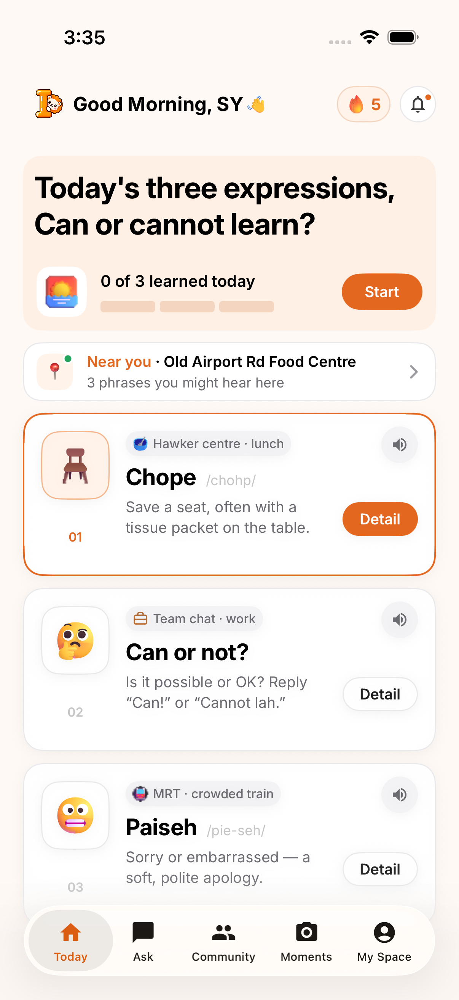
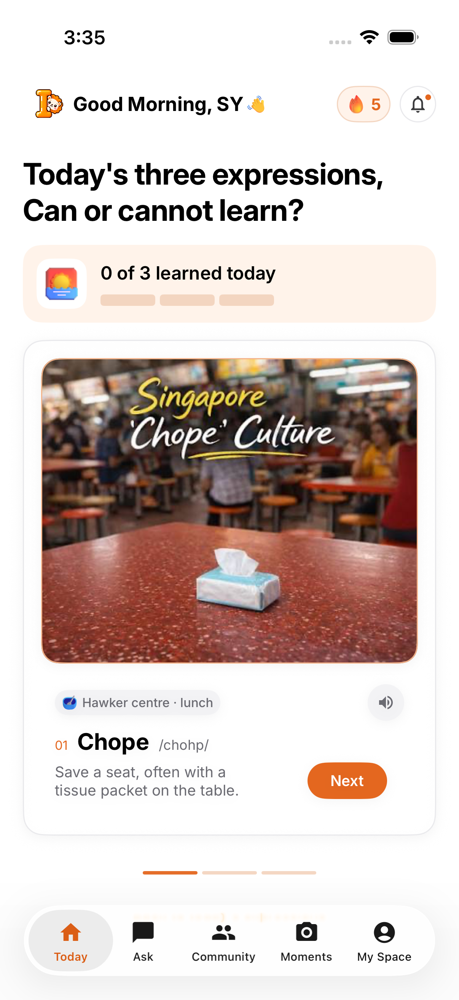

Hi, see our live demo here on Vercel: https://cde-5311.vercel.app

# Singlish Daily — React + SwiftUI

The React web app covers all seven pages and 19 main screens; the native SwiftUI prototype covers the two Home screens in the [Week 7 Figma file](https://www.figma.com/design/aAPocY386mzfKwK5nqjGkB/Week-7?node-id=1-2).

 

## React web version — Vercel

The deployable React app is in [`web/`](web/README.md). The native SwiftUI app is included alongside it.

```sh
cd web
npm ci
npm run dev
```

For Vercel, import this repository and set **Root Directory** to **web**, framework **Vite**, build command **npm run build**, and output directory **dist**. No environment variables are required. See the [web setup and deployment guide](web/README.md).

## SwiftUI iOS version

### Open and run

1. Open `SinglishDaily.xcodeproj` in Xcode.
2. Select the **SinglishDaily** scheme and an iPhone simulator.
3. Press **Run** (⌘R).

Requires Xcode 16 or newer and iOS 18+. Verified with Xcode 26.4 and an iPhone 17 Pro simulator running iOS 26.4. No third-party Swift packages are required.

To run on your own iPhone, choose your development team in **Signing & Capabilities**. Simulator builds do not require a team.

## Prototype flows

- **Today:** overview cards, phrase details, nearby sample phrases, notifications, a sample five-day streak, and a three-step lesson flow. Next and Finish record learned expressions.
- **Ask:** local sample answers for Chope, Can or not?, and Paiseh.
- **Community:** demo posts and interactive likes.
- **Moments:** create personal text memories and swipe to delete.
- **My Space:** saved expressions, learning progress, and a reset action.

Phrase details support speech playback with `AVSpeechSynthesizer`, saving, and marking an expression as learned. Progress, saved expressions, and moments persist with `UserDefaults`. Speech voices depend on the device.

The supplied Home designs guide the colors, cards, images, and typography. Native `TabView`, `NavigationStack`, `Form`, `List`, and sheets provide iOS navigation and presentation; iOS renders its own status bar and home indicator. The native tab bar adapts to the installed iOS version. All bundled assets render locally, and Inter uses Dynamic Type-aware custom fonts. The app currently follows the light palette in Figma.

The other tabs, detail sheets, completion view, and second/third lesson illustrations extend the two supplied Home screens for demonstration. The location, streak, notifications, and community posts are sample data. The phrase set is fixed; progress does not roll over automatically each day. No server, authentication, live location, or AI API is connected. Likes last for the current app session.

## Tests

In Xcode, press **⌘U**, or run:

```sh
xcodebuild -project SinglishDaily.xcodeproj \
  -scheme SinglishDaily \
  -destination 'platform=iOS Simulator,name=iPhone 17 Pro' \
  -derivedDataPath build \
  CODE_SIGNING_ALLOWED=NO test
```

Choose a simulator installed on your machine. All six tests passed on the iPhone 17 Pro simulator. Three unit tests cover persisted learning/saved state, moment validation/deletion, and local answers. Three UI tests cover lesson completion and relaunch persistence, expression saving and Ask, and creating a moment. UI tests use an isolated UserDefaults suite and do not clear your normal app data. Home and lesson screenshots are attached to the UI test results.

## Project structure

- `SinglishDailyApp.swift`: app entry and native tab navigation.
- `Models.swift`: phrase data, observable learning state, persistence, and speech.
- `HomeView.swift`: Home overview, lessons, detail sheets, and nearby view.
- `ExploreViews.swift`: Ask, Community, Moments, and My Space.
- `Theme.swift`: shared brand colors, Dynamic Type fonts, and reusable views.
- `Assets.xcassets`: Figma images, exported vector assets, and named color tokens.

`project.yml` is the optional XcodeGen source. The generated Xcode project is committed, so XcodeGen is not needed to open or run the app. To regenerate it after target changes, run `xcodegen generate`.

## Asset credits

Images and icons were exported from the supplied Figma file. SVGs were converted directly to PDF assets while preserving their original dimensions and vector content. Inter is bundled from the Google Fonts distribution under the SIL Open Font License; the license is included in `SinglishDaily/Resources/Fonts/OFL.txt`.
