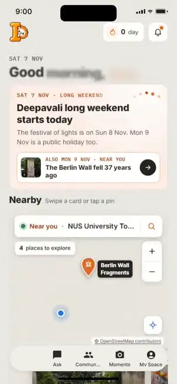
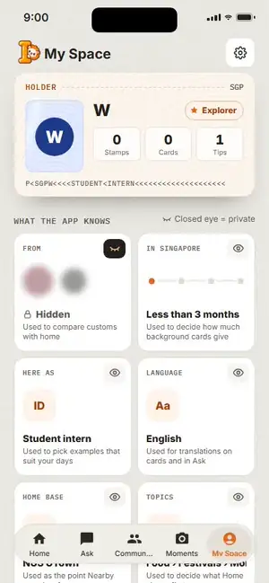

# IntentAI

**A phone-first guide to Singapore's culture, one place at a time.** Open a place near you, read its food, monument,
festival and history cards, and collect a passport stamp for every place you finish.

The current app is the React + TypeScript web app in [`intentai-web/`](intentai-web/README.md). The live demo
(https://cde-5311.vercel.app) still serves the older [`web/`](web/README.md) app until production switches over.

<table>
  <tr>
    <td align="center" width="50%"></td>
    <td align="center" width="50%"></td>
  </tr>
  <tr>
    <td align="center"><b>Home</b><br>A live map of places near you, synced to a swipeable photo carousel.</td>
    <td align="center"><b>Place stories</b><br>Four culture cards per place: Food, Monument, Festival, History.</td>
  </tr>
  <tr>
    <td align="center"></td>
    <td align="center"></td>
  </tr>
  <tr>
    <td align="center"><b>Onboarding</b><br>Six quick questions fill your passport, then it gets its first stamp.</td>
    <td align="center"><b>My Space</b><br>See and edit what the app knows, hide any of it, and control your data.</td>
  </tr>
</table>

## What's in the app

| Tab | What you can do |
|---|---|
| **Onboarding** | Six questions (where you're from, time in Singapore, role, language, home base on a real map, ranked topics) fill a passport card as you answer; the last step stamps it. |
| **Home** | Today's holiday or festival, then **Nearby**: an OpenStreetMap map with pins that follow the photo cards, a place search, and **Explore** for the full Nearby map (2D, list and the 3D city model). |
| **Place stories** | Berlin Wall Fragments (NUS University Town) and Chinatown each have a place page and four cards with articles, stats, a then-and-now slider and timelines. Finish all four to collect the place's **passport stamp**. |
| **Ask** | Ask about a phrase, a dish or a custom and get an answer with examples. |
| **Community** | Ask locals and read answered questions. |
| **Moments** | Your passport: stamps, places and the phrases you have collected. |
| **My Space** | "What the app knows" tiles you can edit or hide; **Settings** (text size and motion apply app-wide); **Privacy & data** (storage per group, export, delete everything, page-timing opt-out); **Terms & licences** with every photo credit. |

Everything is stored on the phone (`localStorage`); there is no account. The only network traffic is map tiles and
anonymous page timing for the user test, which you can turn off in My Space › Privacy & data.

## Run it

```sh
cd intentai-web
npm install
npx vite --host 127.0.0.1   # then open http://127.0.0.1:5173
```

Tests (from `intentai-web/`): `npx tsc -b && npm test` for unit tests, `npx playwright test` for end-to-end and
accessibility checks. `npm run dev` works too; it serves on `localhost`, which on some Windows machines resolves to IPv6 only and does not
connect, hence `127.0.0.1` above. More detail, including the production switch from `web/` to `intentai-web/`, is in the
[intentai-web README](intentai-web/README.md).

## Repository layout

| Path | What it is |
|---|---|
| [`intentai-web/`](intentai-web/README.md) | **The current app.** React 18, TypeScript, Vite, CSS Modules, Vitest and Playwright. |
| [`web/`](web/README.md) | The older JavaScript web app that the Vercel demo still serves. |
| `SinglishDaily*`, `project.yml` | Native SwiftUI prototype (see below). |
| `docs/` | Team documents: the [Nearby Explorer PRD](docs/NEARBY-EXPLORER-PRD.md) and the clips used in this README. |

## Nearby Explorer (in `intentai-web/`)

**Nearby Explorer** is a 2D map of Singapore places with a synchronized list, area and location modes, place stories with source-linked fun facts, a draft "Singapore collection" of 100 places with Save / self-reported Visited, backup/restore, phrase tips that open Ask and Moments, and a draggable 3D view of the EARTH ONLINE (City Brush) Singapore model around each place (time of day, weather and sound; tap a landmark for its card), built to load only the nearby area on phones. It is built on the EARTH ONLINE Singapore dataset and calls no Google APIs. Scope and decisions: [PRD](docs/NEARBY-EXPLORER-PRD.md) (its Google Places and Malaysia parts were dropped by team decision on 20 Oct 2026) and the [intentai-web README](intentai-web/README.md).

The deployed site still serves `web/`. Switching production to `intentai-web/` (with one-time migration of existing browser data, and rollback) is described in [intentai-web/README.md](intentai-web/README.md#deployment-root-migration-and-rollback).

## Older web app (`web/`) — Vercel

The currently deployed React app is in [`web/`](web/README.md); the TypeScript successor is in [`intentai-web/`](intentai-web/README.md). The native SwiftUI app is included alongside them.

```sh
cd web
npm ci
npm run dev
```

For Vercel, import this repository and set **Root Directory** to **web**, framework **Vite**, build command **npm run build**, and output directory **dist**. No environment variables are required. See the [web setup and deployment guide](web/README.md).

## SwiftUI iOS prototype

The native prototype covers the two Home screens of the original design and extends them to the other tabs for demonstration.

 

### Open and run

1. Open `SinglishDaily.xcodeproj` in Xcode.
2. Select the **SinglishDaily** scheme and an iPhone simulator.
3. Press **Run** (⌘R).

Requires Xcode 16 or newer and iOS 18+. Verified with Xcode 26.4 and an iPhone 17 Pro simulator running iOS 26.4. No third-party Swift packages are required.

To run on your own iPhone, choose your development team in **Signing & Capabilities**. Simulator builds do not require a team.

## Prototype flows

- **Today:** overview cards, phrase details, nearby sample phrases, notifications, a sample five-day streak, and a three-step lesson flow. Next and Finish record learned expressions.
- **Ask:** local sample answers for Chope, Can or not?, and Paiseh.
- **Community:** demo posts and interactive likes.
- **Moments:** create personal text memories and swipe to delete.
- **My Space:** saved expressions, learning progress, and a reset action.

Phrase details support speech playback with `AVSpeechSynthesizer`, saving, and marking an expression as learned. Progress, saved expressions, and moments persist with `UserDefaults`. Speech voices depend on the device.

The supplied Home designs guide the colors, cards, images, and typography. Native `TabView`, `NavigationStack`, `Form`, `List`, and sheets provide iOS navigation and presentation; iOS renders its own status bar and home indicator. The native tab bar adapts to the installed iOS version. All bundled assets render locally, and Inter uses Dynamic Type-aware custom fonts. The app currently follows the light palette in Figma.

The other tabs, detail sheets, completion view, and second/third lesson illustrations extend the two supplied Home screens for demonstration. The location, streak, notifications, and community posts are sample data. The phrase set is fixed; progress does not roll over automatically each day. No server, authentication, live location, or AI API is connected. Likes last for the current app session.

## Tests

In Xcode, press **⌘U**, or run:

```sh
xcodebuild -project SinglishDaily.xcodeproj \
  -scheme SinglishDaily \
  -destination 'platform=iOS Simulator,name=iPhone 17 Pro' \
  -derivedDataPath build \
  CODE_SIGNING_ALLOWED=NO test
```

Choose a simulator installed on your machine. All six tests passed on the iPhone 17 Pro simulator. Three unit tests cover persisted learning/saved state, moment validation/deletion, and local answers. Three UI tests cover lesson completion and relaunch persistence, expression saving and Ask, and creating a moment. UI tests use an isolated UserDefaults suite and do not clear your normal app data. Home and lesson screenshots are attached to the UI test results.

## Project structure

- `SinglishDailyApp.swift`: app entry and native tab navigation.
- `Models.swift`: phrase data, observable learning state, persistence, and speech.
- `HomeView.swift`: Home overview, lessons, detail sheets, and nearby view.
- `ExploreViews.swift`: Ask, Community, Moments, and My Space.
- `Theme.swift`: shared brand colors, Dynamic Type fonts, and reusable views.
- `Assets.xcassets`: Figma images, exported vector assets, and named color tokens.

`project.yml` is the optional XcodeGen source. The generated Xcode project is committed, so XcodeGen is not needed to open or run the app. To regenerate it after target changes, run `xcodegen generate`.

## Asset credits

Images and icons were exported from the supplied Figma file. SVGs were converted directly to PDF assets while preserving their original dimensions and vector content. Inter is bundled from the Google Fonts distribution under the SIL Open Font License; the license is included in `SinglishDaily/Resources/Fonts/OFL.txt`.
