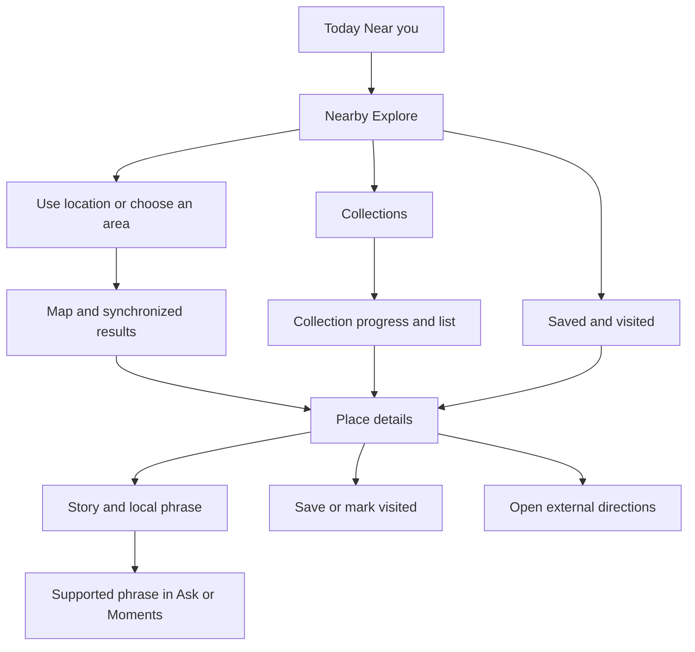

# Nearby Explorer Product Requirements

**Product:** IntentAI / Singlish Daily  
**Version:** 1.0 draft for implementation  
**Date:** 20 October 2026  
**Audience:** Product team, designer, content editor, and the agent implementing this feature  
**Primary repository:** [CDE5311-Aug2026/team-1](https://github.com/CDE5311-Aug2026/team-1)  
**Inspected code baseline:** [`f852b545b094cdd918861e909b702022a3576039`](https://github.com/CDE5311-Aug2026/team-1/tree/f852b545b094cdd918861e909b702022a3576039)  
**Existing site:** [cde-5311.vercel.app](https://cde-5311.vercel.app/)

## 1 Product decision

Expand Nearby from a simulated location and phrase card into an interactive map for discovering landmarks, local stories, restaurants, and food. Add curated destination checklists for Singapore and Malaysia, with places users can save and mark as visited.

The core experience is: **find somewhere interesting → learn why it matters → discover what to eat or say there → save or visit it → build a personal exploration history.** Place stories and relevant language tips connect this feature to IntentAI's existing purpose of helping people understand everyday local life.

Use Google Maps JavaScript API for the interactive map and Places API (New) for live business discovery. Keep original, source-reviewed destination stories and checklist membership in the repository. Keep personal progress on the device for version 1. Open Google Maps for directions rather than building navigation. These are proposed implementation defaults, subject to the dependencies in section 18.

Version 1 includes two independently curated collections: **100 Places to Explore in Singapore** and **100 Places to Explore in Malaysia**. These are editorial suggestions for residents and visitors, not official national lists or obligations of citizenship. A smaller demonstration must show its actual published count and cannot claim that either full collection is complete.

This PRD specifies the React web implementation. Native SwiftUI parity, account services, and a real AI backend are outside this release.

## 2 Repository baseline and implications

There are two React applications in the team repository. They are separate implementations, not interchangeable folders.

| Area | What exists | Implication for this feature |
| --- | --- | --- |
| `web/` | React 19, JavaScript, Vite, plain CSS; `DesignApp.jsx` wires 19 Figma screens; state under `singlish-v2-state` | This is the existing production app identified by its query-based screen routes. Preserve it for deployment rollback. |
| `intentai-web/` | Added in the merged October 15 PR; React 18, TypeScript, React Router, CSS Modules, Vitest, Testing Library, Playwright, and axe | **Implement new Nearby work here.** Reuse the dedicated components and validated stores instead of expanding `DesignApp.jsx`. |
| Nearby page | `intentai-web/src/pages/NearbyPage/NearbyPage.tsx` draws decorative map blocks and displays locally selected phrase content | Replace the decorative map with an SDK-backed map. Keep language guidance accessible. |
| Place selector | `PlacesPage.tsx` selects nine settings such as Hawker centre and Office | These are language contexts, not geocoded destinations. Retain them as a separate manual phrase flow. |
| Location | `PlacesPage.tsx` requests browser location but discards the returned coordinates and persists only `settings.location` | Introduce a permission-aware location controller. An enabled setting alone cannot establish a current position. |
| Persistence | `src/data/persistentStore.ts` and `stores.ts` validate local data, support subscriptions, and retain an in-memory fallback | Register new stores centrally and extend `deleteAllData()`. Do not introduce isolated component storage keys. |
| Ask and Moments | `AskHandoff`, `addLookup`, `lookupsStore`, phrase playback, and toast Undo already exist | Reuse them for supported local phrases. A place story must not be passed to the canned Ask engine as if it can answer arbitrary travel questions. |
| Navigation | Five bottom tabs: Today, Ask, Community, Moments, My Space; Nearby is entered through Today | Keep the five tabs. Add navigation inside Nearby rather than adding a sixth bottom tab. |
| Deployment | The production Vercel project currently has root `web`; `intentai-web/vercel.json` rewrites all paths to `index.html` | Shipping changes in `intentai-web/` requires a tested deployment-root change and API-safe SPA routing. A successful local build alone does not update the current site. |

Relevant baseline files, pinned to the inspected commit:

- [Nearby page](https://github.com/CDE5311-Aug2026/team-1/blob/f852b545b094cdd918861e909b702022a3576039/intentai-web/src/pages/NearbyPage/NearbyPage.tsx), [place selector](https://github.com/CDE5311-Aug2026/team-1/blob/f852b545b094cdd918861e909b702022a3576039/intentai-web/src/pages/NearbyPage/PlacesPage.tsx), and [phrase content](https://github.com/CDE5311-Aug2026/team-1/blob/f852b545b094cdd918861e909b702022a3576039/intentai-web/src/pages/NearbyPage/nearbyContent.ts).
- [Routes and handoff types](https://github.com/CDE5311-Aug2026/team-1/blob/f852b545b094cdd918861e909b702022a3576039/intentai-web/src/routes.ts), [application routes](https://github.com/CDE5311-Aug2026/team-1/blob/f852b545b094cdd918861e909b702022a3576039/intentai-web/src/App.tsx), [persistent stores](https://github.com/CDE5311-Aug2026/team-1/blob/f852b545b094cdd918861e909b702022a3576039/intentai-web/src/data/stores.ts), and [domain types](https://github.com/CDE5311-Aug2026/team-1/blob/f852b545b094cdd918861e909b702022a3576039/intentai-web/src/data/domain.ts).
- [Existing Nearby end-to-end tests](https://github.com/CDE5311-Aug2026/team-1/blob/f852b545b094cdd918861e909b702022a3576039/intentai-web/e2e/nearby.spec.ts), [design tokens](https://github.com/CDE5311-Aug2026/team-1/blob/f852b545b094cdd918861e909b702022a3576039/intentai-web/src/styles/tokens.css), and [current Figma coverage](../web/docs/FIGMA-COVERAGE.md).

The existing Figma Nearby frames are [Heads up](https://www.figma.com/design/aAPocY386mzfKwK5nqjGkB/Week-7?node-id=11-1414) and [Where are you](https://www.figma.com/design/aAPocY386mzfKwK5nqjGkB/Week-7?node-id=11-1571). They establish the visual language and phrase flow. The interactive discovery, place details, and checklist screens are new product scope and require new layouts; they must not be described as existing Figma designs.

## 3 Problem and goals

The current Nearby screen helps users understand phrases in a chosen setting, but cannot answer where they should go, what is actually nearby, or what makes a place interesting. The sample map cannot be explored, food discovery is absent, and there is no reason to return after reading the phrase card.

The new feature should help a user make one practical decision within a short session: choose a nearby place, understand something meaningful about it, and save it or obtain directions. Collections should support exploration over weeks without requiring an account or location access.

| Goal | Intended result |
| --- | --- |
| Discover real places | Map pins and result cards refer to identifiable destinations and businesses. |
| Make local culture approachable | Reviewed stories, etiquette, food context, and relevant phrases explain the place. |
| Help users choose food | Nearby restaurants, cafes, and curated hawker destinations appear with available practical information and clear recommendation reasons. |
| Encourage repeat exploration | Collections, saved places, visited state, and progress survive relaunch. |
| Work without GPS | Users can choose a city or area and use every core discovery and checklist flow manually. |
| Preserve the existing app | Onboarding, learning, Ask, Community, Moments, My Space, and existing data continue to work after deployment. |

Non-goals for version 1: turn-by-turn navigation, route optimization, table reservations, food delivery, payments, public reviews, social feeds, public leaderboards, automatic GPS check-ins, background tracking, an unrestricted AI travel assistant, custom user-authored collections, and cloud synchronization. Future language support must distinguish Singapore usage from Malaysian regional usage; the app must not label all Malaysian language as Singlish.

## 4 Users and principal scenarios

| User | Need | Primary journey |
| --- | --- | --- |
| New resident or exchange student | Understand the area and everyday culture | Choose an area, discover a landmark, read a story, learn a useful phrase, save it. |
| Local resident | Find less familiar places and food | Filter by nature, heritage, or food; explore a collection; track personal visits. |
| Visitor planning a trip | Explore before arriving, without GPS | Switch country/city, browse the map and collections, save destinations. |
| User looking for lunch | Make a nearby food decision quickly | Choose Food, compare distance and available opening/price information, open directions. |
| User denying location | Use the feature without repeated prompts | Pick a manual area and get equivalent map/list discovery without a user-location marker. |

Example acceptance journey: A student manually selects a Singapore area, sees food and landmark pins, opens a curated food-centre destination, reads a sourced local story and ordering tip, saves it, opens directions, and later marks it visited. Its collection count updates once and remains correct after reload.

## 5 Release scope

All requirements marked **Must** are required for the full version 1 release. The demonstration milestone is a smaller validation step, not a redefinition of version 1.

| Capability | Demonstration milestone | Full version 1 | Later |
| --- | --- | --- | --- |
| Interactive map and synchronized list | Working map with a reviewed seed catalogue | Live map, manual areas, search, categories, recenter, selected pins | Offline maps and route planning |
| Nearby food | Live provider integration exercised with test credentials | Restaurants/cafes plus curated food destinations, honest missing data, directions | Reservations and delivery |
| Place stories | At least 10 reviewed destinations in each country | Every checklist entry has a reviewed story and source | Audio tours and editorial CMS |
| Collections | Real counts, such as “Singapore starter collection · 10 places” | Two published collections of exactly 100 unique destinations each | Themed and user-created collections |
| Save and visited | Device-local state, Undo, persistence | Same plus export/import and complete deletion | Accounts and cross-device sync |
| Existing language guidance | Legacy manual context flow and supported phrase handoff | Reviewed destination-to-context mappings and regional labels | Live conversational assistance |
| Analytics | Local/debug measurement adapter | Optional consent-based measurement with no location payloads | Experiments after sufficient usage |

Do not ship a faux map as the completed map feature. If credentials are unavailable, the agent can finish a deterministic preview and a functional curated list, but must identify live-map and live-food acceptance as blocked by configuration.

## 6 Information architecture and journeys

Nearby contains three top-level sections: **Explore**, **Collections**, and **Saved**. Explore has a map/list switch; Collections contains collection detail and progress; Saved contains saved destinations and a Visited filter. A destination opens a single reusable place-detail screen from any of these sections.

Proposed routes, centralized in `routes.ts`:

| Route | Purpose |
| --- | --- |
| `/nearby` | Explore landing; map or list selected by query parameter |
| `/nearby/places` | Existing manual language-context selector, retained |
| `/nearby/location` | New country, city, area, and location-consent controls |
| `/nearby/place/:placeKey` | Destination or provider place detail |
| `/nearby/collections` | Collection catalogue |
| `/nearby/collections/:collectionId` | Collection progress and destinations |
| `/nearby/saved` | Saved and visited places |

Use a namespaced `placeKey`, such as `curated:sg-example` or `google:PLACE_ID`, so curated IDs and provider IDs cannot collide. Route builders encode values and route readers validate them. Query parameters may contain view, country, area ID, category, and a non-sensitive submitted search term. Do not include the user's precise coordinates in app URLs. Browser Back restores the previous section, filter, and list position. Direct links work after reload and do not require onboarding first.



Change Today’s Near you entry to open Explore even when location is off. The present behavior sends users directly to the manual phrase selector when location is off, which would hide the new feature from first-time users. Keep “Phrases for a setting” as an explicit link inside Nearby.

## 7 Functional requirements

### 7.1 Location and geographic context

**NBR 01 — Must.** Default to manual exploration. On first entry, show a Singapore city overview labelled “Exploring Singapore”, with equal choices to use location or change area. Do not request browser geolocation on page load. Country is chosen explicitly; do not infer citizenship or nationality.

The initial overview shows our published curated destinations and does not automatically call paid place-search endpoints. Selecting an area, accepting Use my location, submitting search, or pressing Search this area commits a discovery request. Keep the currently searched area distinct from the country overview shown before a search.

**NBR 02 — Must.** Offer Singapore and Malaysia, with curated city/area centres. The initial Malaysia area is Kuala Lumpur; support searching and browsing published destinations across the country, including Sabah and Sarawak. Manual exploration and checklist browsing must work from any physical country.

**NBR 03 — Must.** “Use my location” first explains that location will be sent to the application's search service and Google Maps to find places, then requests browser permission. Read latitude, longitude, timestamp, and accuracy from the result. Use a one-time position request with a 10-second timeout and a maximum accepted age of 60 seconds. Do not start a background watch. Recenter is an explicit refresh action.

**NBR 04 — Must.** Distinguish manual, requesting, active, denied, unavailable, and timed-out states. `settings.location` is a preference, not proof of permission or a fresh fix. If accuracy is worse than 500 metres, show “Approximate location”; do not claim a precise distance. Revocation or switching location off immediately clears the in-memory user position and cancels pending location searches. Late permission/search callbacks cannot re-enable it.

**NBR 05 — Must.** Distances use the device fix only when valid. Otherwise label them “from selected area” or “from map centre”; never “from you”. Use straight-line distance with `Approx.` and units. Do not infer walking time or border-crossing time from straight-line distance. A coordinate near the Singapore–Malaysia border does not establish that a place is easily reachable on foot.

**NBR 06 — Must.** If current location is outside the supported countries, show that local discovery is supported in Singapore and Malaysia and retain manual exploration. Do not silently relocate the user or display a fabricated location dot.

### 7.2 Interactive map and results

**NBR 07 — Must.** The map supports pan, zoom, recenter, selectable pins, selected-pin styling, and clustering where pins overlap. Categories are All, Landmarks, Food, Nature, and Culture. Pins and list cards use category labels/icons in addition to colour. Selecting either representation selects the same place and exposes its preview.

**NBR 08 — Must.** Start with a 2 km nearby search radius around an active fix or selected area. Offer 1 km, 2 km, and 5 km. A country-level collection map may show all its curated entries independently of this discovery radius. A food search is limited to the selected area/radius; do not represent the provider’s returned subset as an exhaustive inventory.

**NBR 09 — Must.** Panning does not launch paid searches on every frame. After the map settles, expose “Search this area”; the user commits a new search. Show the requested radius overlay and label where it differs from the visible map bounds. Do not promise that an arbitrary rectangular viewport is fully searched by a circular request. “Redo search” and filters are explicit new requests.

**NBR 10 — Must.** List mode is a complete alternative to the map, with the same filtered result set, selection, Save, and details actions. It remains usable if the map SDK is unavailable. Preserve Google attribution where required for provider results displayed without a map.

**NBR 11 — Must.** Support place-name and food-type search with a submitted query of 2–100 characters. Search the curated catalogue locally and call provider Text Search only on submission. Country/area selection constrains the intended search; validate and label out-of-area matches instead of trusting a location bias as a hard country restriction. No paid autocomplete is required in version 1.

**NBR 12 — Must.** Show loading, empty, provider failure, disabled live search, and offline states. Keep the last successful result set during a refresh, but label it if the refresh fails. Cancel obsolete requests or discard responses using request IDs so a slow earlier query cannot replace a newer result.

### 7.3 Food and restaurant recommendations

**NBR 13 — Must.** Food mode finds provider restaurants and cafes and merges matching curated food destinations. Hawker centres and food courts may need curated entries and text search rather than assuming a provider category exactly matches the local concept. Use provider type names supported by Places API (New), not legacy type documentation.

**NBR 14 — Must.** A result card shows name, category, available distance, source label, Save, and one recommendation reason. Show rating/review count, opening status, and price level only when returned by the selected API field mask. A missing value is “Not available”, not zero, free, or closed. Prices retain supplied currency/context; use S$ for independently maintained Singapore prices and RM for Malaysian prices. Never convert a provider price level into an invented meal price.

**NBR 15 — Must.** Offer Recommended and Nearest sorting. Offer Open now only when current-opening data is configured; exclude unknown opening status from that filtered subset and explain the effect. Price and cuisine refinements are optional version 1 enhancements and must not appear as active controls unless their data and filtering work. Halal certification or dietary safety must never be inferred from cuisine, a name, or a generic restaurant category.

**NBR 16 — Must.** Recommendation reasons describe actual signals: “Near your selected area”, “In your Singapore collection”, or “Food destination selected by our editors”. Separate provider business information from our editorial recommendation. Do not claim “locals recommend”, “best”, “safe for allergies”, or a live discount without supporting data. Exclude known permanently closed businesses from live recommendation candidates; temporary closures retain a clear unavailable label.

**NBR 17 — Must.** Directions opens a cross-platform Google Maps URL for the selected destination. Prefer a destination place ID when available; otherwise use independently maintained destination coordinates/name. Omit origin so our link does not transmit the user's precise position. The user can choose walking, transit, or driving in Google Maps. Do not mark a destination visited when directions is opened.

### 7.4 Place details and cultural learning

**NBR 18 — Must.** Place detail shows the place name, location/area, category, source, available practical information, map focus, Save, Mark visited, Directions, and collection membership. Curated destinations additionally show an original short description, at least one reviewed fun fact, and source links. Generic provider-only places show “No local story yet” rather than generating a fact.

**NBR 19 — Must.** Fun facts are concise, useful, and attributable: approximately 40–80 words per fact, up to three per destination. Include a source title/link and last-reviewed date. Appropriate subjects include place history, architecture, food culture, public art, nature, or etiquette. Contested claims require corroboration or omission. Avoid unsupported superlatives and copying source passages. Browsing a source is not permission to reuse its photographs.

**NBR 20 — Must.** Where editorially relevant, include “What you might hear here”, a phrase meaning/example, region label, and existing audio control. Reuse `nearbyContent` mappings for Singapore contexts. Preserve the nine-setting manual phrase flow under “Phrases for a setting”. Malaysian regional tips must be explicitly reviewed for that region; omit tips where no suitable content exists.

**NBR 21 — Must.** Saving a supported phrase uses `addLookup` and the existing Moments flow with deduplication and Undo. “Ask about this phrase” passes a supported prompt/context through `AskHandoff`. Place facts remain accessible in the detail screen. Do not advertise arbitrary location Q&A while `AskPage/answer.ts` is a canned local answer engine. Editorial content must not be falsely marked “Confirmed by a local”; extend the source type and validators to support a truthful editorial label where needed.

### 7.5 Collections and progress

**NBR 22 — Must.** Collection cards show country, title, editorial introduction, published place count, visited count, percentage, and Continue exploring. Collection details support list/map, category and region filters, All / Not visited / Visited, and local text search. With a valid location or selected area, users may sort by approximate distance; otherwise use editorial order.

**NBR 23 — Must.** Each full country collection contains exactly 100 distinct, published canonical destinations. Only destinations with validated coordinates, usable public access, reviewed content, and source provenance count. A whole country, an entire city, a duplicate entrance, and a renamed version of the same site are not separate checklist entries. A food centre and an individual stall can both exist as places but must not count twice for one editorial destination without an explicit editorial reason.

**NBR 24 — Must.** “Mark visited” is a self-reported action available without GPS. Default the optional visit date to today in the user's local calendar; allow an earlier valid date and reject future dates. “Visited” is not a verified check-in. A user may also mark an unsaved place visited. Save and Visited are independent booleans; removing a save does not erase the visit. Removing a visit does not erase a save.

**NBR 25 — Must.** Visit actions are idempotent and offer Undo. A place shared by future collections counts once in each collection containing it, using one global visit record. Progress is `visited published member IDs / published member IDs`; filters never change the denominator. In version 1, exact-100 published collections remain fixed; subsequent collection revisions use versioned membership and explain denominator changes. Retired places retain the user's historical visit without silently visiting their replacement.

**NBR 26 — Must.** At 10%, 25%, 50%, and 100%, show a small optional milestone acknowledgement. Respect reduced motion. Do not require public sharing, repeated modal interruptions, or GPS proof. Completion means the user has marked all current collection members visited, not that the app verified travel.

**NBR 27 — Must.** Version 1 provides JSON export/import of personal saved/visited state with a schema version, plus reset through My Space. Export only our canonical IDs/provider IDs, dates, preferences, and personal flags; do not export Google business descriptions, ratings, photos, or API response caches. Import validates size/schema, accepts at most 1 MB and 5,000 records, unions saved/visited state by canonical ID, and lets users preview counts before merging. Unknown IDs remain recoverable and do not increase collection counts.

## 8 Screen and interaction specification

Reuse Inter, the existing warm backgrounds, `--accent: #e4671f`, 16 px cards, 20 px mobile gutters, `AppShell`, `Toggle`, `Dialog`, audio controls, and toast conventions. Preserve unrelated Figma-based screens. Orange can identify selections; supporting map categories require distinct icons and accessible labels.

| Screen | Required content and behavior |
| --- | --- |
| Explore | Title and location/area chip; Explore / Collections / Saved; submitted search; category chips; map/list control; map with recenter; result preview/list; Phrases for a setting link. Never place a location prompt over the only browsing path. |
| Location | Country, city/area selection, explanation of provider sharing, Use my location, request status, manual fallback, and location-off control. Keep geographic areas separate from language settings. |
| Place preview | Name, category, distance origin, concise recommendation reason, Save, and View details. A selected map pin must have a keyboard-accessible equivalent in the list. |
| Place detail | Practical information, story/facts and sources, appropriate language tip, collection memberships, Save, Visited/date, and Directions. Back restores previous exploration state. |
| Collections | Two country collections with real counts and progress; incomplete starter collections are clearly labelled. |
| Collection detail | Intro, progress, list/map, country regions, category and visit filters, search, and Continue exploring. No fake 100-item skeleton presented as published content. |
| Saved | Saved and Visited views, country filter, empty guidance, removal/Undo, detail links, and export/import entry. |
| Legacy phrases | Existing nine-setting selector and heads-up phrase experience remain reachable, with no fake live map distance. |

At 390 × 844, show a roughly 280–340 px map panel with a compact result preview and a clear way to open the full list. The exact new layout should be validated in a wireframe before polish. A detail sheet may expand into a full-height screen. Keep controls, map attribution, dialogs, and toasts clear of the bottom tab bar and safe area.

At 320 px, use a stacked layout with wrapping filters and no horizontal document overflow. At tablet/desktop widths, allow a map/list split within the existing content width. Do not scale the old fixed screenshot frame to implement the map. Test 200% text zoom, keyboard-only operation, screen-reader labels, visible focus, and reduced motion. Key touch actions should have at least 44 × 44 px targets; an operable list must accompany the map.

## 9 Search and recommendation rules

Keep the first release deterministic and explainable. Do not introduce a machine-learning recommender.

1. Gather curated destinations matching country, area/radius, category, and query. For live business discovery, request a bounded provider candidate set for the same committed search.
2. Merge curated and provider entries by explicit provider-ID mapping. Use one canonical place card and combine our editorial overlay with live provider fields. Do not merge similarly named businesses using fuzzy names alone.
3. Apply category, visit, and supported practical filters. Never treat unknown data as a positive match. Exclude known permanently closed businesses from active live recommendations, while retaining historical visits separately.
4. In Recommended mode, use the provider's popularity ranking within its candidate pool. Place matched editorial picks first in a clearly labelled “Our picks” group and show remaining provider results as “More nearby”. This avoids inventing a statistical quality score from sparse ratings. Explain that editorial selection and provider order are separate.
5. In Nearest mode, sort the returned, filtered candidates by approximate straight-line distance from the displayed origin, with canonical ID as a stable tie-breaker. Label the list “Nearest among these results”; a bounded provider pool is not guaranteed to contain every nearest business.

Default discovery category All shows separate curated-discovery and food groups with a combined map. Limit a live category search to 20 candidates per committed request; do not run five searches automatically to fill all categories. Search this area, food search, and named search each replace the relevant live result group rather than continuously accumulating a shadow database. Collection maps use our own complete catalogue and therefore do not require nationwide Places crawls.

Food preference chips may influence editorial grouping after the user selects them. Do not use nationality, inferred ethnicity, citizenship, or private profile fields for ranking. There is no advertising or paid placement in version 1.

## 10 Content and collection publishing

The full feature requires **200 reviewed destination entries**, not merely 200 generated names. Catalogue size and fact quality are a separate deliverable from software functionality.

Proposed editorial allocation is a planning guide, not a factual statement about existing content:

| Collection | Coverage target |
| --- | --- |
| Singapore 100 | Heritage/landmarks 25; food destinations 20; nature 25; arts/culture 15; neighbourhood/public-life destinations 15. Distribute beyond central tourist areas across the island. |
| Malaysia 100 | Peninsular Malaysia 60; Sabah 20; Sarawak 20. Cover multiple states and cities, with a mix of heritage, nature, food, culture, and neighbourhood destinations. Do not fill the list entirely with Kuala Lumpur or Penang entries. |

Every entry requires a stable ID, independently sourced name/coordinates, country and region, category, public-access notes, an original summary, at least one fact with a specific source URL, review date, and editorial owner/reviewer. Practical claims such as admission, restrictions, accessibility, and operating hours must either have their own dated source or be omitted. A photograph requires a recorded license and attribution; an icon is an acceptable fallback.

Suggested source institutions include Singapore's National Heritage Board [Roots](https://www.roots.gov.sg/), [Singapore Tourism Board](https://www.visitsingapore.com/), official parks/museums/site operators, and Malaysia's national/state tourism and heritage bodies. These institutions are research starting points; a home page alone is not evidence for an individual fact. Prefer primary operator or heritage pages for each claim.

Publishing workflow: draft → source check → coordinate/duplicate check → editorial review → published. An implementing agent can propose original copy and candidates; unreviewed content stays draft. A team member assigned as content editor owns approval. Review evergreen stories at least every six months and volatile practical notes before release and at least quarterly thereafter. Provide “Suggest a correction” through the source link or copyable correction text in version 1; do not display a successful submission if no reporting service exists.

Add a catalogue validation command that checks unique IDs, valid country coordinates, reference integrity, fact/source/review fields, forbidden placeholder text, source/image provenance, and collection counts. Coordinate-country checks use an appropriate boundary check rather than relying only on a broad bounding rectangle. Draft collections can contain fewer than 100 entries; a collection claiming to be a published 100 must fail validation unless its 100 members are distinct and published.

## 11 Data model and persistence

The existing `Place` type means a language setting. Keep it unchanged or rename it carefully to `PlaceContext`; add a separate `ExplorePlace` type for physical destinations. Treat provider business content as an ephemeral overlay, separate from owned editorial data.

```ts
type CountryCode = 'SG' | 'MY';
type Category = 'landmark' | 'food' | 'nature' | 'culture';
type PlaceKey = `curated:${string}` | `google:${string}`;

interface SourceReference {
  title: string;
  url: string;
  publisher: string;
  checkedAt: string; // ISO date
}

interface CuratedPlace {
  id: `curated:${string}`;
  name: string;
  country: CountryCode;
  regionId: string;
  areaId: string;
  coordinates: { lat: number; lng: number; source: SourceReference };
  category: Category;
  summary: string;
  facts: { id: string; text: string; sources: SourceReference[] }[];
  languageTip?: { phraseId: string; regionLabel: string; context: string };
  googlePlaceId?: string;
  image?: { path: string; license: string; attribution: string; sourceUrl: string };
  accessNotes?: { text: string; source: SourceReference };
  editorialStatus: 'draft' | 'published' | 'retired';
  reviewedAt: string;
  reviewedBy: string;
}

interface ExploreCollection {
  id: string;
  version: number;
  country: CountryCode;
  title: string;
  description: string;
  status: 'starter' | 'published';
  memberIds: CuratedPlace['id'][];
  targetCount: 100;
}

interface PersonalPlaceState {
  placeKey: PlaceKey;
  saved: boolean;
  visited: boolean;
  visitedOn?: string; // local calendar date, no GPS proof
  updatedAt: string;
}

interface ExplorePersonalData {
  schemaVersion: 1;
  places: PersonalPlaceState[];
  preferredCountry: CountryCode;
  selectedAreaId?: string;
}
```

Store owned catalogue/collections as version-controlled JSON or typed data. Register `explorePersonalStore` centrally using the existing `createPersistentStore`, producing a key such as `intentai:v1:explore-personal`. Do not duplicate membership/progress counts in personal state; derive them from the catalogue and flags. Canonicalize known Google IDs to their curated IDs during save/import, and reconcile duplicates when mappings are added later.

For saved provider-only places, persist the provider ID and personal flags, then hydrate provider display data when online. Do not persist a Google response merely to make the saved card work offline. When it cannot be hydrated, show an unavailable place reference with removal and retry; personal state remains intact. Do not put provider names in document URLs or a personal export as a substitute cache.

Extend `deleteAllData()` to clear exploration records, preferences, export/import drafts, active location, and pending Undo actions. Deletion must not allow an old request or Undo callback to restore data. Storage failure keeps the feature usable in memory and displays “Changes will not be saved on this device” rather than promising persistence.

### 11.1 Migration when changing the deployed application

Switching the deployment root from `web/` changes the storage schema. Add a tested, one-time migration from `singlish-v2-state` into the validated `intentai:v1:*` stores. Check legacy v1 learned/saved keys only when no newer source exists. Preserve onboarding, profile, settings other than location consent, learning/saved state, lookups, questions, reports, and notice decisions where the destination schema can represent them.

Map known phrase IDs explicitly, including legacy `can` to `can-or-not`; preserve real progress without inventing learning dates or a streak. Do not replace populated TypeScript-app stores with legacy defaults. Leave original legacy keys untouched for rollback, mark migration version after successful validation, and retain unconvertible records for recovery rather than silently discarding them. Location must be off until the user accepts the new external-provider disclosure, even if a legacy boolean is true. Add fixtures for populated legacy state, partial/corrupt state, an existing new-app user, and an interrupted migration.

## 12 Provider and backend design

The default architecture keeps the existing Vite application and adds a small server boundary for live place searches. No Next.js rewrite, database, authentication system, queue, or AI service is required for version 1.

| Layer | Responsibility |
| --- | --- |
| React client | Map rendering, user interactions, ephemeral location, curated catalogue, personal stores, and accessible list |
| Map SDK adapter | Lazy-load Google Maps once; create/dispose map, markers, listeners, and clusters; expose selection and settled viewport |
| Places client adapter | Typed request/response normalization, cancellation, missing-data handling, and canonical identity |
| Same-origin Vercel Functions | Validate bounded requests, apply rate limits/quotas and allowlisted provider field masks, call Places API with the server key, redact logs |
| Owned catalogue | Publish reviewed destination facts, images, coordinates, and collection membership independent of provider response storage |
| External Google Maps URL | Handle directions and detailed route planning |

Google requires maps showing Places results to use a Google map, limits storage of Places content, and allows place IDs to be retained under its documented exception. Keep provider attribution visible in map and list contexts and review any photo attribution requirements before adding photos. Do not combine Google Places data with an alternative map renderer or copy it into our permanent catalogue. See [Google Places policies](https://developers.google.com/maps/documentation/places/web-service/policies).

### 12.1 Proposed API contract

Use POST for searches so user coordinates do not appear in request URLs and ordinary URL logs. Disable body logging for these endpoints. Public destination IDs are suitable for detail URLs. Responses carrying provider results use `Cache-Control: no-store`; do not add application/CDN persistence of provider content without a separately reviewed permitted basis.

| Endpoint | Input | Output and rules |
| --- | --- | --- |
| `POST /api/explore/nearby` | `{ country, center: {lat,lng}, radiusM, category }` | `{ places, searchedAt, source, requestId }`; bounded candidate set; category mapped server-side; radius restricted to 1000/2000/5000; no pagination promise |
| `POST /api/explore/search` | `{ country, areaId, query, center? }` | Same normalized envelope; query length 2–100; explicit submitted search; validate geographic result scope |
| `GET /api/explore/place?id=...` | Validated provider place ID | Detail overlay, attribution, fetch timestamp, and optional practical fields; no arbitrary upstream URL |

Normalized ephemeral results contain provider ID, display name, coordinates, category/types, available address, business status, optional rating/count/price/opening information, source attribution, and provider link. Do not interpret absent fields as false. Owned editorial facts are joined locally by canonical ID, not generated by these endpoints.

Errors use `{ error: { code, message, retryable }, requestId }`, with 400 invalid input, 429 throttled/quota reached, 502 upstream failure, 503 live service disabled, and 504 upstream timeout. Set an 8-second upstream timeout. Retry once only for transient network/5xx failures with jitter; never retry invalid requests, denied credentials, or exhausted quotas automatically. Validate latitude/longitude ranges, finite numbers, allowed country/category, body size at most 8 KB, and query lengths. Do not accept client-supplied field masks, URLs, API keys, or unlimited result counts.

[Nearby Search (New)](https://developers.google.com/maps/documentation/places/web-service/nearby-search), [Text Search (New)](https://developers.google.com/maps/documentation/places/web-service/text-search), and [Place Details (New)](https://developers.google.com/maps/documentation/places/web-service/place-details) support this separation. Their response field masks affect returned data and billing. In particular, opening hours, rating, and price fields can increase the charged SKU. Configure required fields deliberately; do not use wildcard masks in production.

### 12.2 Keys and cost controls

Proposed configuration names:

- `VITE_GOOGLE_MAPS_BROWSER_KEY`: browser-visible key restricted to authorized domains and the map API. It is not a secret.
- `VITE_GOOGLE_MAP_ID`: map configuration ID if needed by the chosen marker implementation.
- `GOOGLE_PLACES_SERVER_KEY`: server-only Places credential, API-restricted and never prefixed `VITE_`. Apply appropriate server restrictions supported by the deployment architecture; do not assume serverless egress has a fixed IP.
- `EXPLORE_LIVE_ENABLED`: server kill switch; disabled returns the explicit unavailable response while curated browsing remains usable.
- `VITE_EXPLORE_MODE`: explicit live or demo mode. A demo must display its status; never silently substitute mocked restaurants when live calls fail.
- `EXPLORE_RATE_LIMIT_PER_MINUTE` and an account/project daily quota: initial proposed defaults of 10 requests per minute per visitor/IP and 500 total provider requests per day for the class pilot, adjustable before launch.

Enforce quotas in a shared platform mechanism or durable counter; module memory in a serverless function is not a global limit. Aggregate limits, provider quotas, and the kill switch protect the anonymous endpoints. Do not rely on CORS or the Origin header as authentication. Keep any rate-limit identifier short-lived and out of product analytics.

Lazy-load map code on entering Explore. Reuse the map instance during normal interaction, deduplicate identical in-flight requests, and avoid automatic paid searches on typing or panning. Request richer details on opening a place rather than enriching all map pins. Keep live-result data only for the active interaction, subject to provider policy.

Use separate development/preview/production credentials or restrictions. Provide `.env.example` with names only. Document restrictions, enabled APIs, billing ownership, quota changes, and preview-domain setup. Set billing alerts, but treat them as notifications rather than a guaranteed spending cap. The team must choose an actual currency budget before enabling production billing. Forecast cost from expected map loads, submitted searches, and detail requests using the [current official pricing table](https://developers.google.com/maps/billing-and-pricing/pricing); do not promise a free production service.

## 13 Privacy and data handling

The current place-selector copy says location stays on this device. That is no longer accurate once a live place provider receives coordinates. Replace the copy before enabling live location search, and add a short provider-sharing explanation and a public privacy page.

Suggested first-use text: “Use your location to find places nearby. Your location is sent to our search service and Google Maps for this search. We do not save your location history. You can choose an area instead.” This is product copy to validate against the actual deployed data flow.

Keep precise user position in memory only. Do not put it in localStorage, personal exports, analytics, app URLs, error reports, or request logs. Search services necessarily process submitted coordinates; deployment logging must redact bodies and provider payloads. An embedded map also contacts Google when exploring a manual area, so manual mode does not imply that no third party is contacted. Explain that distinction in the privacy information.

Saved/visited data stays in the current browser, may be lost if browser storage is cleared, and is not synchronized. Do not send it to Google for recommendations. The export/import flow provides user-controlled backup. No account, real name, photo, or GPS proof is required to mark a visit. My Space deletion includes this data, cancels active operations, and cannot resurrect it through Undo.

Geolocation requires a secure context and user permission; design the manual fallback for unsupported browsers and denied permission. See the [Geolocation API documentation](https://developer.mozilla.org/en-US/docs/Web/API/Geolocation_API). Apply the [Google API security guidance](https://developers.google.com/maps/api-security-best-practices) to credential restrictions. Terms, attribution, and privacy requirements must reflect the selected provider before public launch; this PRD is not a claim of legal compliance.

## 14 Repository implementation plan

Use a feature branch from the latest **team repository main**. The original `Wsamme/CDE-5311` remote may lag the team repository. Re-fetch and inspect repository instructions before editing; the baseline above is pinned for traceability and must not overwrite subsequent team work.

Proposed structure under `intentai-web/`:

```text
api/explore/                  # Vercel Functions: bounded provider requests
src/features/nearby/
  components/                 # map, result card, filters, detail sections
  hooks/                      # location, request lifecycle, map adapter
  services/                   # provider contract and normalization
  domain.ts                   # destination, collection, personal-state types
  identity.ts                 # provider-to-curated canonical mapping
  ranking.ts                  # filtering and deterministic ordering
src/data/explore/
  places.sg.json              # owned editorial content only
  places.my.json
  collections.json
  areas.json
src/pages/NearbyPage/          # expand existing pages; add detail and collection screens
scripts/validate-explore.mjs   # catalogue and published-count validation
```

| Existing file or area | Required change |
| --- | --- |
| `src/pages/NearbyPage/NearbyPage.tsx` | Make Explore the default; replace decorative map; mount map/list controls and preserve language entry. |
| `PlacesPage.tsx` and `nearbyContent.ts` | Preserve manual language contexts; correct location disclosure and remove fake live distance; add reviewed mappings without conflating contexts and physical places. |
| `src/pages/TodayPage/TodayPage.tsx` | Near you opens Explore regardless of location preference. Update its label honestly when it lacks real nearby results. |
| `src/routes.ts` and `src/App.tsx` | Add centralized route builders, dynamic patterns, and routes. Preserve old routes. |
| `src/data/stores.ts` and validators | Register exploration store, canonicalize state, extend deletion and validated import. |
| `src/data/persistentStore.ts` | Reuse store behavior; expose storage failure status if needed rather than silently claiming saved progress. |
| `src/data/domain.ts`, Moments source badges, Ask handoff | Extend only as needed for truthful editorial provenance and supported phrase context. |
| Startup migration module | Convert legacy deployed state once, retaining source keys and existing new-app state. |
| `src/components/AppShell/` and `src/styles/tokens.css` | Reuse shell/tokens; add map-aware layout and stacking rules without global regressions. |
| `e2e/nearby.spec.ts` and geometry tests | Replace obsolete decorative-map expectations with map/list behavior and reviewed new layout assertions; retain legacy phrase-flow coverage. |
| `vercel.json`, Vite development config, package scripts | Ensure API routing works before SPA fallback; support local function integration; add content validation. |
| Repository README and a new `intentai-web/README.md` | Document the chosen production app, setup, credentials, demo/live modes, tests, data ownership, and deployment rollback. |

Use the existing TypeScript, CSS Modules, React Router, test stack, and domain-store conventions. A map SDK loader and clustering package are justified if needed. Do not install a new UI framework, rewrite unrelated tabs, replace all state management, or add a database merely to implement local checklists.

## 15 Performance and reliability targets

These are proposed acceptance targets for the pilot, not measured results from the existing app.

| Measure | Target and method |
| --- | --- |
| UI response | Selected pin, card, and local saved/visited state reflect input within 200 ms on the reference test device, excluding network. |
| Map readiness | Usable map within 3 seconds in at least 90% of controlled Fast 4G test runs after entering Nearby; list and loading status remain usable earlier. Record device/browser and cold/warm cache conditions. |
| Search response | Results or an actionable failure within 5 seconds in at least 90% of successful-provider pilot requests; timeout ends waiting within the documented deadline. |
| Large collection | Both 100-place lists and a clustered collection map remain responsive on a mid-range mobile device. |
| Accessibility | No serious/critical automated axe findings in app-owned Nearby controls; manual keyboard/list and screen-reader checks still required. |
| Persistence | Save/visit survives reload and another tab sees state changes; corrupt or unavailable storage does not crash the feature. |
| Failure isolation | Map/Places outage leaves curated content, collections, saved flags, and manual phrases usable. Fully offline cold starts are not promised without a separate app-shell caching implementation. |

Instrument provider timeouts, quota failures, map-load failures, and aggregate request counts without coordinates or query bodies. Show useful fallback copy, never blank map containers indefinitely. SDK effects must clean up listeners and markers on unmount and tolerate React development remounts.

## 16 Measurement and pilot success

Run a task-based pilot with approximately 10–15 classmates or representative users before expanding recommendations. Proposed success criteria: at least 80% can find a suitable place and open directions within two minutes without assistance; at least 80% can save and mark a collection place visited; at least 80% correctly understand that visits are self-reported and progress stays on the device. Record observed task failures and revise before treating percentages as product evidence.

Useful funnel events are `nearby_opened`, `search_submitted`, `place_detail_opened`, `fact_expanded`, `place_saved`, `directions_opened`, `place_marked_visited`, `collection_opened`, `collection_milestone`, and `location_request_result`. Limit properties to session ID, selected country, broad category, surface, live/demo mode, result-count bucket, and coarse error/permission status. Do not collect raw coordinates, raw search text, precise place IDs, visit dates, or full saved lists in product analytics.

If analytics is not configured or consent is absent, no third-party measurement is sent; retain a local development adapter for test verification. Measure discovery-to-detail rate, detail-to-save/directions rate, checklist activation, weekly return to Nearby, and failure rates after sufficient real traffic exists. Avoid setting arbitrary growth commitments before a baseline is available. An opened directions link is an intent signal, not a completed visit.

## 17 Acceptance and test matrix

Use deterministic provider fixtures for CI and a small separately configured live smoke test for the actual SDK/API. A passing mock test cannot certify live provider integration.

| ID | Scenario | Required evidence |
| --- | --- | --- |
| A01 | First entry with location off | Explore opens without permission prompt; manual Singapore overview and Change area are usable. |
| A02 | Location granted | Coordinates and accuracy are consumed; map recentres; real distance origin shown; no position persists. |
| A03 | Denied, unavailable, timeout, inaccurate position | Distinct useful states; manual browsing works; inaccurate fix labelled; no fake location dot. |
| A04 | Turn location off while a request is pending | Position clears; late response cannot restore location or show distance from you. |
| A05 | Outside supported countries and border area | Manual country browsing remains; no inferred walking accessibility across the border. |
| A06 | Pin/card selection and clustering | Same canonical place selected; cluster expands; list provides keyboard access. |
| A07 | Pan and zoom | No paid query during gestures; Search this area submits one bounded request and radius is clear. |
| A08 | Category, search, and stale responses | Correct subset; submitted search only; earlier response cannot override a later query. |
| A09 | Food with missing rating/hours/price | No invented values; Open now excludes unknown status when supported; certification not inferred. |
| A10 | Provider failure, rate limit, key failure, offline | Explicit live failure; curated list and collection progress remain usable; no silent mock substitution. |
| A11 | Duplicate provider/curated destination | One card and one personal record; identity does not depend on approximate name matching. |
| A12 | Curated detail versus provider-only detail | Sourced fact/date shown for curated place; provider-only detail does not invent a story. |
| A13 | Save and visit independence | Saving does not visit; visiting does not require saving; removing either retains the other; repeat action does not duplicate. |
| A14 | Undo | Restores exactly the changed state; cannot undo after global deletion. |
| A15 | Collection progress and filters | Correct numerator/denominator, including shared membership and 100/100 completion; filter does not change denominator. |
| A16 | Starter versus full collection | Real count visible; unpublished/draft or duplicate records cannot satisfy the 100-place gate. |
| A17 | Export/import | Valid merge is idempotent; bad JSON, oversize files, unknown IDs, and invalid dates handled without losing state. |
| A18 | Relaunch, multiple tabs, corrupt/unavailable storage | Valid progress retained; changes synchronize; fallback message accurate; no crash. |
| A19 | Legacy migration | Old and populated new-app fixtures preserve recoverable records; location requires new consent; migration is repeat-safe. |
| A20 | Language flow | Nine manual settings remain; supported phrase saves once to Moments and opens relevant Ask context; no fabricated local confirmation. |
| A21 | Directions | Correct destination URL and encoded ID; origin omitted; opening directions does not mark visited. |
| A22 | Deep links and Back | Every new detail/collection route reloads; invalid ID has a useful not-found state; filters/scroll return. |
| A23 | Responsive and accessible UI | 320/390/768/1440 px, short viewport, 200% text zoom, keyboard/list, screen reader, reduced motion, attribution clearance. |
| A24 | Existing features | All unrelated unit, routing, integration, geometry, and end-to-end suites pass, with intentional Nearby layout updates documented. |
| A25 | API boundary | Invalid bounds/body/field-mask overrides rejected; quotas enforced across instances; server key absent from built client. |
| A26 | Privacy | Network/storage/log checks confirm no location history, analytics coordinates, persisted Google response cache, or inaccurate on-device-only copy. |
| A27 | Preview and production routing | `/api/explore/*` returns expected JSON, not `index.html`; SPA deep links load correctly. |
| A28 | Configured live smoke test | Real SDK renders; one real nearby food search and detail request succeed; attribution visible; request/response evidence redacted. |

Baseline commands from `intentai-web/` are `npm ci`, `npm test`, `npm run build`, and `npm run e2e` after installing/configuring a Playwright browser. Add `npm run validate:explore` for the catalogue. Confirm the existing Playwright server configuration and local Vercel Functions workflow before choosing test commands for live API integration. Do not report tests as passed if credentials or browsers prevented them from running.

## 18 Delivery milestones and decisions

Milestones are dependency-based; dates and effort estimates should be set by the implementing agent after inspecting current code and available credentials.

| Milestone | Work and exit condition |
| --- | --- |
| M0 Layout and integration spike | Wireframes for Explore, detail, and collection; map SDK plus one server search in a preview; verify API and SPA routing, credential restrictions, quota mechanism, and regional coverage. |
| M1 Demonstration | At least 10 reviewed places per country; live map/food exercised; save, self-reported visit, truthful starter counts, manual fallback, and legacy phrase handoff. Teacher can complete the principal journey. |
| M2 Full version 1 | 100 reviewed published destinations per country, validated content, all Must requirements, migration/export/import/deletion, accessibility, and failure states. All release tests pass. |
| M3 Production rollout | Preview signoff, deployment-root migration, provider smoke tests on production, user-data migration checked, root README updated, and rollback rehearsed. |

Recommended defaults and unresolved ownership:

| Decision | Default | Owner or dependency |
| --- | --- | --- |
| Map/provider | Google Maps + Places API (New) | Team supplies billing-enabled project and restricted browser/server keys; no provisioning or spending is authorized by this document. |
| Implementation app | `intentai-web/` | Implementing agent confirms latest team main and keeps `web/` available for rollback. |
| Full collections | Singapore 100 and Malaysia 100 | Team assigns content editor/reviewer; smaller milestone uses honest starter titles/counts. |
| Data model | Device-local accountless progress | Team accepts lack of cross-device sync; export/import included. |
| Visits | Manual, self-reported | No background location or verified check-ins. |
| UI language | English, preserving local proper names | Translation is a later release unless separately requested. |
| API cost ceiling | Must be set before live production | Team names billing owner, currency budget, alert thresholds, and enforceable quotas; pilot request defaults are only starting limits. |
| Deployment | Test new app under preview, then migrate existing project root | Deployment operator confirms Vercel project and authorization before an actual production change. |

If a dependency is missing, finish the unaffected frontend, fixtures, validation, and documentation; list the precise remaining live/content gate. Do not mark the whole feature complete with mock results or unreviewed catalogue entries.

### 18.1 Production rollout and rollback

1. Build a preview from the latest team repository with root `intentai-web`. Configure preview-only credentials and real function routes; revise the catch-all SPA rewrite so it cannot swallow `/api/*`. The Node.js runtime supports server request handlers; follow [Vercel's current runtime documentation](https://vercel.com/docs/functions/runtimes/node-js) for implementation details.
2. Run the existing complete new-app test suite and the new matrix. Compare unaffected screens against existing design expectations. Run legacy-state migration on copied test fixtures, not by clearing a user's production storage.
3. Run a limited live smoke test with allowed credentials, verify attribution/privacy copy, and record the published catalogue count. M1 may be deployed as a labelled preview but must not be announced as the full 100+100 release.
4. Record the previous production deployment ID, root directory, configuration, and account linkage. Existing documentation records a commit-author linkage problem with automatic Git deployment; check current status rather than assuming every push deploys.
5. When deployment is authorized, change the project root to `intentai-web`, build with `npm ci` / `npm run build`, output `dist`, and configure server environment variables. Retain the same public domain. Verify real API JSON, place deep links, onboarding, existing progress, and manual mode on the production domain.
6. If errors exceed the accepted rollout threshold or migration fails, restore the previous production deployment and previous project-root configuration. Do not delete legacy storage keys or the `web/` app during this release; the older app must remain able to read its original state.

## 19 Handoff prompt for the implementation agent

Copy the following into the next agent's task, together with this document:

> Implement the Nearby Explorer PRD in CDE5311-Aug2026/team-1. Start from the latest team main, inspect repository instructions and this PRD, and use `intentai-web/` for the implementation. The existing production root is `web/`; keep it intact for rollback and plan/test the deployment migration explicitly. Preserve unrelated Figma-based screens and user data.
>
> Build an interactive map and synchronized accessible list; location with manual fallback; nearby restaurant/cafe discovery; reviewed place stories; Singapore and Malaysia collections; independent Save and self-reported Visited state; accurate progress; export/import; and the existing phrase-to-Ask/Moments flow. Follow the requirement IDs and acceptance matrix. Use Google Maps and Places API (New) through restricted credentials and a bounded server boundary, with attribution, quota protection, and honest failure modes. Never fabricate live businesses, ratings, distances, fun facts, or 100-item completion.
>
> Deliver a working vertical slice first with at least 10 reviewed entries per country and honest starter labels. Full version 1 requires 100 reviewed published destinations per country and every Must requirement. Add catalogue validation and meaningful unit/integration/end-to-end coverage. Report credential/content blockers explicitly, together with completed work and reproducible test commands. Do not provision paid services or deploy production merely because this PRD describes those steps; obtain the task owner's applicable authorization. Supply a reviewable branch or PR, setup instructions, screenshots of the new screens, test evidence, and a deployment/rollback plan.

## 20 Completion criteria for the handoff

The implementation is ready for product review when the principal journey works in the preview, required tests and content validation pass, user data survives migration, and provider failure has a usable fallback. It is ready for a full release only after the 200-entry content gate, live provider checks, agreed cost controls, and production rollout checks are satisfied. The PR description must state which milestone is delivered and list any remaining gates.
