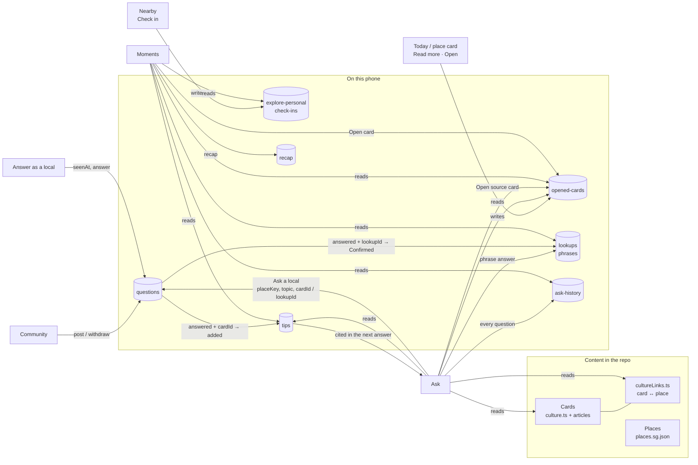

# Ask · Community · Moments — PRD v3 (merged)

- **Product:** IntentAI (`intentai-web/`)
- **Version:** 3.0 draft for implementation · 29 Oct 2026
- **Audience:** owner, teammates, designer, and the agent implementing it
- **Inputs merged:**
  1. **Intent v3 Figma** (`Intent v3.fig`, exported 28 Oct 2026): the newest design. Sections: Home → place cards, Ask A1–A5,
     Community C1–C5, Moments M1–M5, Onboarding O1–O8, My Space S1–S4. Boards for the three tabs: `docs/design-boards/`.
  2. **Live site** [cde-5311.vercel.app](https://cde-5311.vercel.app): it serves `intentai-web` (team-1 `main`; checked 29 Oct 2026:
     the bundle has the user-test gate and Nearby, and no Circles). Today, Nearby (2D/3D), phrase Ask, Community (My
     questions / Answer as a local), Moments (Singlish passport, place stamps).
  3. **Ask from cards**, built 29 Oct 2026 on `integration/v2-nearby` (not yet committed when this was written): see §5.
  4. **Tab map** (`intentai-tab-map.html`, 29 Oct 2026). It analysed the older `web/` app on branch
     `cursor/intentai-storyboard-loop-e5ee` (phrase Explain with Where/Who/Topic and confidence, topic Circles, `lookupId`).
     **That app is not the live one.** This PRD keeps that app's good rules, listed in §2, and answers its three open questions in §1.

Status words in this document: **Built** (in `intentai-web` now) · **Partial** · **New** · **Deferred**.

---

## 1 Decisions (answers to the tab map's open questions)

| Question | Decision | Why |
|---|---|---|
| Is Ask "decode a phrase I heard" or "ask about the places I've collected"? | **Both, in one composer.** Card questions about a place are the main path (Figma A1–A5). A Singlish phrase is detected and explained as today (live). | The Figma loop needs card questions. Phrase decoding is the app's original value and is already built and tested. One input is enough because the router (§5.3) can tell them apart. |
| Community: topic Circles or place-based locals with two doors? | **Place-based, two doors** (Figma C1–C5). No Circles. | Circles exist only in the old `web/` branch, not on the live site. Place is the unit that joins cards, Ask, Nearby and Moments. |
| Moments: phrase ledger or place passport? | **Place passport + "Collected" shelf** (Figma M1–M5). Phrases stay, as one kind of collected item, with their source tag (AI-generated / Confirmed by a local). | The passport is the new design. The live Singlish passport and lookups become a filter of Collected, so nothing that users already saved is lost. |

**One loop, five steps:** open cards at a place → **Ask** answers from those cards → if the cards can't answer, **Ask a
local** → the local's answer is **added back to the card** as a tip → the place's **stamp gains ink** in Moments.

---

## 2 Rules carried over from the older `web/` app (tab map)

These were right and stay, renamed to the new objects:

1. **A closed loop needs a link.** A Community question can change a card or a phrase only if it carries the id of
   that card (`cardId`) or phrase (`lookupId`). A question without either may get answered, but nothing else changes, and
   the app must not say it did (the old app had a false "Confirmed" toast; that bug must not come back).
2. **Ask answers stay what they were.** A later local answer never rewrites an earlier Ask answer. It shows up as a tip
   the next time Ask cites that card.
3. **Never "High" confidence, never fake people.** No invented local names, counts, "94 % match" or "Mei answered" pushes.
   Sample content is labelled **Sample**.
4. **Privacy line, same words everywhere:** "Locals see your question and place, never your name or location."
5. **Style lock:** stroke SVG icons in `currentColor`, the lion logo, text status pills, accent `#E4671F`, one card radius
   (20 px, `tokens.css`). No new icon font.

---

## 3 Objects

| Object | What it is | Where it lives | Status |
|---|---|---|---|
| **Card** | One sourced article: `Article` (`summary`, `facts`, `deeper`, `sources`, `checkedOn`) + optional video + image. Topic: food · monument · festival · history. | `src/data/culture.ts`, `src/data/articles/*`, `videos.ts`, `articleImages.ts` | Built (18 cards) |
| **Place** | A Nearby catalogue place `curated:sg-…` or an area `sg-…`. | `src/data/explore/places.sg.json`, `areas.json` | Built (173 places, 21 areas) |
| **Card ↔ place link** | Which cards belong to which place (the text names it, or a stall serves the dish). | `src/data/cultureLinks.ts` (`ARTICLE_LINKS`) + `PLACE_AREAS` in `src/pages/AskPage/cards.ts` | Built |
| **Place set** | The cards of one place, one per topic (Figma: 4 cards → "3 of 4 opened"). | derived from links | Partial: today 1–3 cards per area, never 4 |
| **Opened card** | A card the user opened (Today *Read more*, Ask *Open*, place card *Open*). | `openedCardsStore` (`intentai:v1:opened-cards`) | Built (29 Oct) |
| **Check-in** | Self-reported visit to a place; gives the place its stamp. | `explorePersonalStore` (`visited`) | Built |
| **Phrase (lookup)** | A Singlish phrase the user asked about. Source: AI-generated or Confirmed by a local. | `lookupsStore` | Built (no source tag yet) |
| **Ask exchange** | One question + answer in the Ask chat. | page state; **New:** `askHistoryStore` | Partial |
| **Question** | A Community question. | `questionsStore` (`Question` in `src/data/domain.ts`) | Built (4 statuses, links) |
| **Tip** | A local's answer attached to a card. | `tipsStore` (`intentai:v1:tips`) | Built |
| **Recap result** | Knew it / see again, per fact. | **New:** `recapStore` | New |

### 3.1 Data changes (TypeScript, `src/data/domain.ts` + `stores.ts`)

All new keys go through `createPersistentStore` with a validator, are cleared by `deleteAllData`, and are included in
the backup / restore file.

```ts
// Question: extended in slice 2. Old records stay valid with no migration: 'Pending' means posted.
type QuestionStatus = 'Pending' | 'Seen' | 'Answered' | 'Added';
interface Question {
  id: string; text: string; context: string; detail: string;
  status: QuestionStatus;
  answer?: string;
  // New, all optional so old records stay valid:
  areaId?: string;        // for "near here" → "near Chinatown" and the map circle
  areaName?: string;      // short name shown to locals ("Chinatown")
  topic?: 'food' | 'monument' | 'festival' | 'history' | 'other';
  cardId?: string;        // source card: an answer can be added to it
  lookupId?: string;      // source phrase: an answer can confirm it
  from?: 'ask' | 'community' | 'moments';
  postedAt?: number; seenAt?: number; answeredAt?: number;
  answeredBy?: string;    // display first name the local typed, e.g. "Mei"; never the asker's name
  sample?: boolean;       // seeded demo content
}

interface Tip {            // tipsStore, key 'tips'
  id: string; cardId: string; questionId: string;
  text: string; by: string; areaName?: string;
  createdAt: number; cited: number; sample?: boolean;
}

interface Lookup { /* existing */ source?: 'ai' | 'local'; localNote?: string }

interface AskRecord {      // askHistoryStore, key 'ask-history', last 50
  id: string; question: string; subjectId: string;
  kind: 'card' | 'phrase' | 'none'; cardId?: string; lookupId?: string; at: number; saved?: boolean;
}

interface RecapResult { factId: string /* `${cardId}#${index}` or `phrase:${id}` */; knew: boolean; at: number }
```

### 3.2 Values worked out from the stores (never stored)

| Value | Rule |
|---|---|
| Cards of a place | `ARTICLE_LINKS` entries whose place/area is that place (Ask today groups by area: Chinatown = chicken rice, Sri Mariamman, Thian Hock Keng). |
| Ink % of a stamp | opened cards of the place ÷ cards of the place. A stamp exists only after a check-in. |
| Rank | Visitor (0–2 opened cards) → Explorer (3–7) → Insider (8–13) → Local (14+ **and** ≥ 1 tip received). Thresholds are a team choice; show "N more cards to …". |
| Badges | First stamp (1 check-in) · Local tip (1 tip on any card) · Two districts (stamps in 2 areas) · Festival fan (all festival cards of 1 place opened) · Full set (one place 4/4) · Historian (1 history card opened). Progress ring = done ÷ needed. |
| "Recommended for you" | Built: card you opened → same-topic card you opened → your Today topics → other card here. Each item states its reason. |
| Question pin status | added/answered → **Answered** · posted/seen (yours) → **Waiting** · others' open questions while Answer as a local is on → **Needs a local**. |

---

## 4 Data flow



### 4.1 Events

| Event | Writes | Then visible in |
|---|---|---|
| Open a card (Today Read more, Ask Open, place sheet Open) | `opened-cards` += id | Ask recommendations (reason), Moments ink, rank |
| Check in at a place | `explore-personal.visited` | Moments stamp; Nearby ✓ |
| Ask a card question | `ask-history` | Moments "Collected → Asked" (if saved) |
| Ask a phrase question | `lookups` (+ source `ai`), `ask-history` | Moments Collected → Phrases |
| Ask a local (from Ask) | `questions` += {status `posted`, placeKey, areaId, topic, cardId \| lookupId, from `ask`} | Community My questions, status map |
| A local opens the question (Answer as a local) | `seenAt`, status `seen` | progress strip step 2 |
| A local sends an answer | `answer`, `answeredBy`, status `answered` | My questions (New), Ask a local tip block |
| …and the question has `cardId` | `tips` += {cardId, questionId}; status `added` | card shows "+1 local tip"; Ask cites it; Moments ink unchanged, tip counted in Collected and badges |
| …and the question has `lookupId` | lookup `source = 'local'`, `localNote`; status `added` | Moments phrase shows "Confirmed by a local" |
| …and neither | status stays `answered` | toast: "Answer saved. It isn't linked to a card." |
| Withdraw | removes the question (Undo 10 s); a tip already added stays | — |
| Delete all my data | clears every store above | — |

---

## 5 Ask

### 5.1 Purpose
Answer questions about a place **only from the cards of that place**, show where each answer comes from, and hand
anything the cards can't answer to a local. Also explain Singlish phrases, as the live app does.

### 5.2 Screens (Figma A1–A5) and what exists

| Part | Figma | Status | Notes |
|---|---|---|---|
| "Asking about [place] · N cards" | A1 | **Built** (areas) | Next: place-level subjects (e.g. a single landmark) once a place has ≥ 2 cards. Default = Today's *Near you* place if it has cards, else the area with most cards. |
| Greeting + Pick a topic tiles + Suggested questions | A1 | **Built** | One suggested question per card, bound to that card. |
| Topic switch Food · Monument · Festival, follows typing | A1 | **Built** | Topics the place lacks are disabled. Figma has no History in Ask; add it when history cards link to places. |
| Line under the input: which card will answer ("Answering from your food card · Bak kwa") | A1/A2 | **New** | Live preview from `askFromCards(draft)` while typing; the same line heads the answer. |
| Answer = card sentences + key numbers | A2–A4 | **Built** | Only sentences from the card; numbers only as the card writes them. |
| Source card (dark) with Open, "Article + 1:40 video" | A2–A4 | **Built** | Open → full card dialog + marks opened. Next: open the real place card screen when it exists. |
| Local tip block ("Mei · Chinatown local", Open in Community) | A2 | **New** | Shown when the source card has a tip in `tips`; increments `citedCount`; label **Local tip** (not "Verified", there is no verification) and **Sample** for seeded tips. |
| "Need a first-hand tip? Ask a local" | A3/A4 | **Partial** | Today it opens Community's dialog with the rewritten text. Next: the C3 sheet with place, topic and source card filled in (§6). |
| Recommended for you, each with a reason | A2–A4 | **Built** | |
| Off-topic: pick a topic or Ask a local; "near here" → "near Chinatown" | A5 | **Built** | |
| Footnote | all | **Built** | "Answers come from your cards and can still be wrong." (no LLM is used; Figma says "AI can still make mistakes" — use that only if an LLM is added). |
| Phrase explainer (chope, can or not, paiseh, sabo) + context | live | **Built** | Phrase answers save a lookup (Moments). Next: "Ask a local" on a phrase answer carries `lookupId`. |
| Copy · helpful · not helpful · report | all | **Built** | |
| History of past asks | (old app) | **New, P2** | From `ask-history`; "Save to Moments" pins an exchange to Collected. |

### 5.3 Routing a question (in order)

1. A known Singlish phrase → **phrase explainer** (context presets as today).
2. Otherwise `askFromCards(question, subject, {topic})`:
   - a card matches (title, shared words, or the detected topic) → **card answer** from the best card;
   - the topic is one the place has no card for → **"There is no festival card for Chinatown yet"** + topics + Ask a local;
   - nothing matches → **off-topic** (A5).
3. No card matched but the question asks what a word means → the phrase explainer's honest fallback ("This prototype can explain …").

### 5.4 Acceptance
- Every sentence in a card answer appears word for word in the source card; every big number appears in a card sentence (unit test: `cards.test.ts`).
- Suggested and recommended questions always answer from their own card (unit test over every place and card).
- No answer claims a tip, a local or a confidence the data doesn't have.
- `/ask` passes axe and has no horizontal scroll at 320 / 390 / 1440 px (e2e).

---

## 6 Community

### 6.1 Purpose
Two doors: **Ask a local** (when your cards can't answer) and **Answer as a local** (help visitors near your places).
Answers flow back to the card that raised the question.

### 6.2 Screens (Figma C1–C5) and what exists

| Part | Figma | Status | Build on |
|---|---|---|---|
| Two doors + the loop strip "You ask → A local answers → It joins your card" | C1 | **New** (live has a segment "My questions / Answer as a local") | `CommunityLayout.tsx`: replace the segment with two door cards; the Answer door holds the same switch (`settings.local`, also in My Space). |
| My questions with icon progress ("1 answered · 1 waiting") | C1 | **Partial** (list + Pending/Answered pill) | `CommunityPage.tsx`, `StatusPill.tsx` → 4-step dots. |
| Privacy line | C1/C3 | **Partial** | One string constant, used in C1, C3 and the dialog. |
| Answered question: mini map, steps Posted → Seen → Answered → Added, answer bubble, Thank, the card with "+1 local tip · Cited in Ask", Context, Withdraw | C2 | **Partial** (question page, withdraw + Undo, context) | `QuestionPage.tsx`; mini map = `CityMap` small, pin at `placeKey`. "Added" only if `cardId`/`lookupId` (§2 rule 1). Thank = local-only reaction counter; no fake "12". |
| Ask a local sheet (from Ask): place chips, reach circle on a mini map, topic tiles with AUTO, "Answers arrive in My questions", counter 0/300, Post | C3 | **New** (live has a plain dialog) | `QuestionDialog.tsx` → sheet; reads `CommunityHandoff` extended with `placeKey, areaId, topic, cardId, lookupId`. Reach circle = the area radius; **no avatar row or locals count** unless real. |
| Answering as a local: question, "Their card already says" (card facts), answer box, coverage ring Entry · Dress · Etiquette · Timing (0/4), Send | C4 | **New** | Coverage = local keyword rules on the answer text (testable). "Sample" button fills a labelled sample. Sending writes §4.1. |
| Status map: desaturated, filter All · Waiting · Needs a local · Answered, pins with ring/badge/label | C5 | **New** | `CityMap` with a desaturate filter + a pins layer from `questions` (status rule §3.2). |
| Notifications ("Mei answered") | — | **Deferred** | No server. On-device toast only, when the local answer is sent on this device. |

### 6.3 Flows
1. **Ask → Ask a local → Post.** Sheet pre-filled (question with "here" rewritten, place, topic, source card). Post → `posted`,
   go to My questions, toast "Posted. Locals see your question and place, never your name."
2. **Answer as a local.** Switch on → C5 shows "Needs a local" pins and a list. Open one → `seen`. Write → coverage ring →
   Send → `answered`; if linked → `added` + tip/phrase update; toast names exactly what changed.
3. **Read the answer.** My questions shows "New"; open → C2 with the steps and, if added, the card with "+1 local tip".
4. **Withdraw** with Undo (built). Withdrawing never deletes a tip already added.

On one demo phone the "local" is the tester switching modes; seeded questions from others are marked **Sample**.

### 6.4 Acceptance
- Step 4 "Added" and the "+1 local tip" appear only for a question with `cardId` or `lookupId` (unit test both ways).
- The toast after answering never mentions a card or Moments unless one was changed.
- Old `questions` records (Pending/Answered, no links) still load and show 3 steps with "Not linked to a card or phrase" (test in `localAnswer.test.ts`).

---

## 7 Moments

### 7.1 Purpose
A passport of the places you've been, inked by the cards you've opened, plus everything you've collected (cards, tips,
saved answers, phrases), with a short recap to remember it.

### 7.2 Screens (Figma M1–M5) and what exists

| Part | Figma | Status | Build on |
|---|---|---|---|
| Passport "My places 2 / 100", stamps, "Ink fills as you open each place's 4 cards", Today row | M1 | **Partial** (`PlaceStamps`: check-ins as stamps, collection progress) | Stamp = check-in; ink % per §3.2; "/ 100" = `sg-100` collection progress (built). |
| Tap a stamp: its cards fan out (opened in colour, rest locked), "Checked in 2 Nov 2026", ink %, Open place, "Add ink: <next card>" | M2 | **New** | Card fan reads the place's cards + `opened-cards`; Open → the card dialog (marks opened → ink updates live). |
| Collected masonry with filters All · Food · Monument · Festival · History (+ **Phrases**) | M1 | **New** (live shows lookups, Today's three, topics) | Items: opened cards, tips (quote + "Mei's tip · Lim Chee Guan"), saved Ask answers, festival countdown ("91 days", from the holiday date in the card), phrases from `lookups` with source tag. |
| Recap: flip cards, swipe right = knew it, score ring, "6 facts · about 1 min" | M5 | **New** (live `PractiseDialog` for phrases) | Facts from opened cards + phrases; results to `recapStore`. Keep Practise as the phrase variant inside Recap. |
| Rank sheet Visitor → Explorer → Insider → Local + 6 badges with rings | M4 | **New** | Rules in §3.2, pure functions with tests. |
| Snap a moment: viewfinder → match → "+1 card · ink added" | M3 | **Deferred → demo** | No image recognition. Demo: pick from a fixed tray of the app's own card photos, labelled **Demo match**; no percentage. |
| Today's three Singlish phrases, topics | live | **Built → move** | Today's three stays on Today; the phrases they collect appear under Collected → Phrases. |

### 7.3 Acceptance
- Ink and rank are recomputed from the stores (no stored totals); opening a card in Ask or Today changes the ink at once.
- A place without a check-in has no stamp, however many cards are opened (it can show as an outline "not visited").
- Every phrase saved before this release still appears, with its source.

---

## 8 Content needed (no invented data)

The Figma screens use content we don't have. Each item needs a sourced article (sources + `checkedOn`) before it is shown:

| Figma content | Status in the repo | Needed |
|---|---|---|
| Berlin Wall Fragments (NUS UTown) place + 4 cards (The Spread, Wall panels, Fall of the Wall, 1961–2016) | **Missing**: not in `places.sg.json` | Place entry with source; 4 articles (Tembusu College / NUS page, berlin.de). The Spread hours: thespread.sg. |
| Chinatown set: bak kwa, Thian Hock Keng, Lunar New Year, 1822 → today | THK **built**; others **missing** (Chinatown has chicken rice + Sri Mariamman instead) | Bak kwa + Lim Chee Guan (NLB Infopedia); Chinatown history (NLB "Chinatown"); a source that ties Lunar New Year to Chinatown before linking it. |
| "4 cards per place" | No place has 4 | Either target 4 per featured place (5 featured places for the user test), or show "N of M" with the real M. |
| Local tips ("Mei · Chinatown local") | none | Only from the Community flow, or seeded and labelled **Sample**. |
| Videos on cards | 5 of 18 | Official Roots.sg-embedded only (carried over from HANDOFF §6). |

---

## 9 Build order

| Slice | Scope | Done when |
|---|---|---|
| **1 · Ask from cards** | §5 Built rows | **Done** 29 Oct (511 unit + 86 e2e tests pass). Commit + push pending. |
| **2 · Linked questions** | `Question` fields; C3 sheet (without the map); 4-step progress; Seen when a local opens it; honest toasts; `tips` store; tip block in Ask and on the source card; phrase `lookupId` path (Ask and Moments "Not sure") | **Done** 29 Oct: rules in `src/data/localAnswer.ts` (+ tests); 524 unit tests and the e2e suites pass; checked by hand: Ask → Post → answer as "Mei" → Ask shows Mei's tip, cited once. |
| **3 · Two doors + answering** | C1 doors, C4 with coverage ring, "Their card already says", C3 mini map with the reach circle | The answering screen replaces today's plain answer dialog. |
| **4 · Passport** | M1 stamps with ink, M2 card fan, Collected with filters (incl. Phrases) | §7.3 passes; old lookups still listed. |
| **5 · Status map, rank, recap** | C5, M4, M5 | rules unit-tested; axe passes. |
| **6 · Content** | §8 articles (Berlin Wall, Chinatown set) | each with sources; `cultureLinks.test` updated. |
| Deferred | Snap (real recognition), push notifications, real multi-user network, LLM answers | — |

Each slice: unit tests for the rules, e2e for the flow, axe on the new screens, no horizontal scroll at 320/390/1440 px.

---

## 10 Out of scope here
Home map + carousel, place screens (Album Rail), Onboarding O1–O8 and My Space S1–S4 are in the same Figma file and
connect to these tabs (home base for "near here"; topic ranking for recommendations; "Answer as a local" switch in My
Space), but they get their own PRD.

## 11 Open questions
1. User-test scope: which 3–5 places get full 4-card sets first (proposal: Chinatown, Kampong Glam, Little India, Katong, Berlin Wall Fragments)?
2. Rank thresholds and badge list (§3.2) — keep as proposed?
3. Should the "local" in a one-phone test be the facilitator (scripted) or the participant switching modes?
4. Production still points at the team's `main`; when does this branch go to team-1 as a PR?
