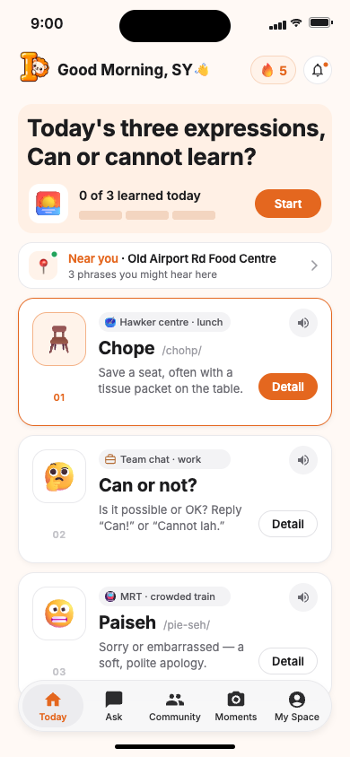
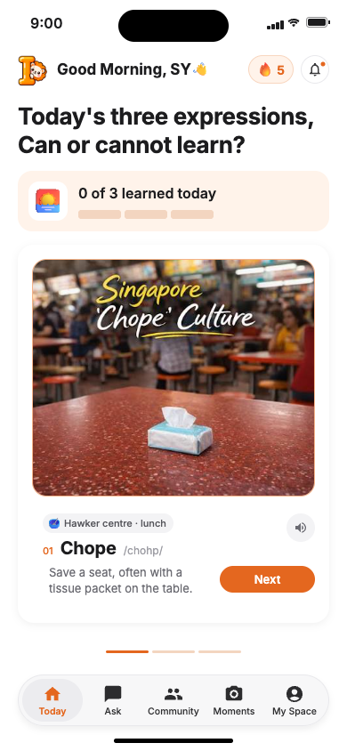

# Singlish Daily — React

A React + Vite prototype of the supplied Figma design, ready to deploy as a static site on Vercel. The native SwiftUI project remains in the repository root.

 

## Run locally

Requires Node.js 22.12+ and npm.

```sh
cd web
npm ci
npm run dev
```

Open http://127.0.0.1:5173. For the production build:

```sh
npm run build
npm run preview
```

## Deploy on Vercel

1. In [Vercel's New Project page](https://vercel.com/new), import **Wsamme/CDE-5311**.
2. Set **Root Directory** to **web**.
3. Choose **Vite** as the framework. Use `npm ci` to install, `npm run build` to build, and `dist` as the output directory. These settings are also in `web/vercel.json`.
4. Use Node.js **22.x** or **24.x**. No environment variables are required.
5. Deploy. Future pushes to the connected production branch can deploy automatically through Vercel's Git integration.

Alternatively, from this folder, use Vercel CLI to link and deploy to the intended account/project:

```sh
vercel
```

## Prototype behavior

- Today: three expression cards, details, pronunciation, nearby sample phrases, and a lesson carousel. Completing a lesson records progress.
- Ask: local demo answers for today's expressions.
- Community: sample posts with interactive likes.
- Moments: create and delete text memories.
- My Space: saved expressions and progress reset.

Learning progress, saved expressions, and moments persist in browser local storage. Pronunciation uses browser speech synthesis; voice availability and pronunciation vary by device. Likes last for the current session.

The two Home screens follow the Figma reference. The other tabs, detail dialogs, completion view, and second/third lesson illustrations extend those designs for demonstration. Location, streak, notifications, and community posts are sample data. The phrase set is fixed and progress does not reset daily. No backend, login, live location service, or AI API is connected.

Figma assets and Inter fonts are served locally from the build; no temporary asset URLs are used at runtime. Layouts adapt to mobile widths and show a centered phone preview on desktop. Native HTML dialogs support keyboard focus and Escape.

## Test

```sh
npx playwright install chromium
npm test
```

Set `PLAYWRIGHT_CHROMIUM_PATH` to use an existing Chromium executable. Set `PLAYWRIGHT_BASE_URL` to test an already-running production preview or deployed app instead of starting Vite. Tests cover assets, runtime errors, lesson completion, persistence, saved expressions, dialogs, demo tabs, and mobile/desktop overflow.

Validation: the production build and all five Playwright tests passed, including mobile and desktop layouts.
